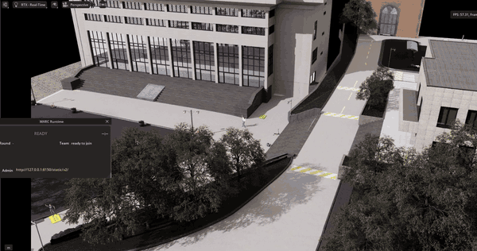
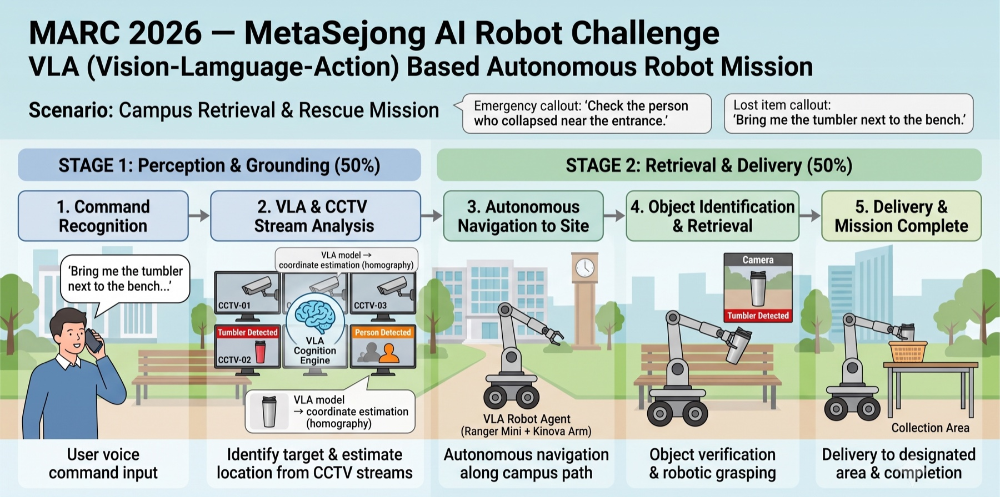
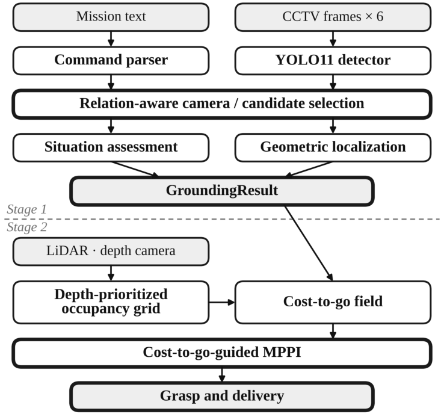
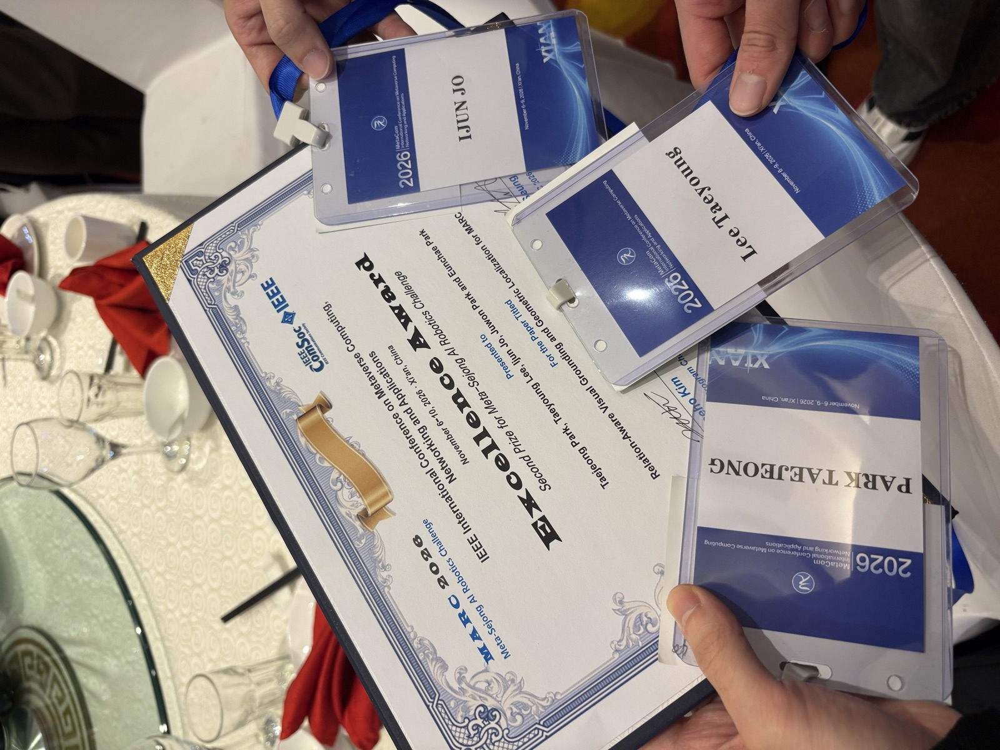

# 자연어 명령 수행을 위한 관계 인지 기하 그라운딩과 Cost-to-Go MPPI

**MARC 2026 (Meta-Sejong AI Robotics Challenge) · 팀 MEC sim ICE (동국대학교)**

CCTV 영상에서 자연어 명령이 가리키는 물체와 사람을 찾아 월드 좌표를 추정하고(Stage 1),
모바일 매니퓰레이터로 그 물체를 회수해 주인에게 전달하는(Stage 2) **모듈형 오프라인 VLA 에이전트**입니다.

> 🏆 **IEEE MetaCom 2026 · MARC 2026 Excellence Award (우수상, 2위)**

📄 논문: [English (IEEE)](paper/MARC2026_paper_EN.pdf) · [한국어 번역본](paper/MARC2026_paper_KO.pdf)

<p align="center">
  
  <br>
  <sub>본선 Stage 2 실행 영상 (48배속) · <a href="mec_sim_ice/docs/assets/demo_stage2_finals_720p.mp4">전체 영상 (11분, 720p)</a></sub>
</p>

---

## 목차

1. [대회 소개](#1-대회-소개)
2. [과제](#2-과제)
3. [파이프라인](#3-파이프라인)
4. [구현](#4-구현)
5. [결과](#5-결과)
6. [저장소 구조와 실행 방법](#6-저장소-구조와-실행-방법)
7. [팀원](#7-팀원)
8. [출처와 라이선스](#8-출처와-라이선스)

---

## 1. 대회 소개

**MARC 2026 (Meta-Sejong AI Robotics Challenge)** 은 IEEE MetaCom 2026과 함께 열린 로봇 AI 챌린지입니다.
**NVIDIA Isaac Sim 캠퍼스 디지털 트윈**(공개 연습 맵: Chungmu) 안에서, 사용자의 자연어 명령을 이해하고
CCTV로 상황을 파악한 뒤 로봇이 직접 물체를 회수하는 **VLA(Vision-Language-Action)** 과제를 다룹니다.



**실행 제약**
- **오프라인 실행**: 채점 환경에는 인터넷이 없습니다. 외부 API를 쓸 수 없고, 모델 가중치는 빌드할 때 이미지에 넣어야 합니다.
- **분리된 실행 환경**: 시뮬레이션 플랫폼과 에이전트는 서로 다른 머신에서 돌고, ROS 2(DDS)로 통신합니다.
- **제출 형식**: 에이전트는 Docker 이미지로 제출하고, 주최 측은 `docker compose up`만 실행합니다.

## 2. 과제

| | Stage 1: 인식과 그라운딩 (50%) | Stage 2: 회수와 배송 (50%) |
|---|---|---|
| 입력 | 자연어 미션 + 고정 CCTV 6대의 프레임 | Stage 1 결과 + 로봇의 LiDAR·깊이 카메라·IMU |
| 할 일 | 대상이 보이는 카메라를 고르고, 대상 종류·관계·상황과 대상·기준물의 월드 좌표를 제출 | 대상까지 주행해 로봇 팔로 집고, 주인이 있는 구역까지 배송 |
| 예시 | *"Check the person who collapsed near the entrance."* | *"Bring me the tumbler next to the bench."* |
| 공개 미션 | 33개 (사람 14, 분실물 19) | 5개 (텀블러·우산, 그중 2개는 택시 주변 밀집 구간) |
| 채점 | 의미 필드 정확 일치 + 좌표 XY 오차 | 파지 50점 + 배송 30점 + 그라운딩 점수 |

**어려운 점**
- CCTV 시야가 거의 겹치지 않고 같은 종류의 물체가 여러 카메라에 반복해서 나와, 검출 신뢰도만으로는 카메라를 고를 수 없습니다.
- 바운딩 박스는 위치 추정에 필요한 물리적 지점(바닥 접점, 놓인 면)을 직접 알려주지 않습니다.
- 주행 중 LiDAR가 일시적 반사와 경사면 바닥을 장애물로 잘못 쌓으면, 목표로 가는 길이 모두 막힐 수 있습니다.

## 3. 파이프라인

<p align="center">
  
</p>

종단 간(end-to-end) 정책이 아니라, **언어가 시각을 제약하고 그라운딩 결과가 행동을 이끄는** 모듈형 파이프라인입니다.

| 단계 | 하는 일 |
|---|---|
| **명령 파서** | 규칙 기반으로 미션 문장을 대상·랜드마크·관계·자세·구역 단서로 나눕니다 |
| **YOLO11 검출기** | 34개 클래스(대상 10, 랜드마크 15, 자세 9)를 검출하고, 타일 검출기가 작은 물체 3종을 보완합니다 |
| **카메라·후보 선택** | 랜드마크·구역 게이트로 카메라를 좁히고, 관계 순위로 대상–기준물 쌍을 고릅니다 |
| **상황 판단 / 위치 추정** | 자세와 주변 문맥으로 상황을 판단하고, 지지면 투영으로 월드 좌표를 계산합니다 |
| **깊이 우선 점유 격자** | LiDAR log-odds 격자에 깊이 카메라로 확인한 바닥을 우선 반영합니다 |
| **Cost-to-go 장** | 목표에서 거꾸로 Dijkstra를 돌려, 격자의 모든 칸에 "목표까지 남은 비용"을 채웁니다 |
| **Cost-to-go 유도 MPPI** | 차체 제약을 지키는 궤적을 샘플링해 cost-to-go 장을 따라 내려갑니다 |
| **파지와 배송** | 깊이 점군으로 물체를 집고, 같은 제어기로 주인 구역까지 전달합니다 |

## 4. 구현

### Stage 1: 관계 인지 그라운딩

- **제약 기반 카메라 게이팅**: 명령에 나온 랜드마크가 검출된 카메라만 남기고(랜드마크 게이트),
  주차장의 차량·공원의 벤치 같은 구역 단서 물체가 한 카메라에 확실히 더 많을 때만 그 카메라로 좁힙니다(구역 게이트).
  단서가 애매하면 좁히지 않아, 정답 후보가 게이트에서 사라지지 않게 합니다.
- **관계 인지 후보 선택**: `on` / `near` / `beside` 같은 공간 관계를 기하로 판정해 대상–기준물 쌍의 순위를 매깁니다.
  `near`와 `beside`는 중심 거리 대신 **XY 평면 OBB 표면 거리**로 구분합니다
  ([분석 문서](mec_sim_ice/docs/design/MARC2026_Chungmu_near_beside_OBB_analysis.md)).
- **지지면 기반 위치 추정**: 바운딩 박스 하단에서 광선–평면 교차로 좌표를 구한 뒤,
  물체의 접지면(footprint), 물체가 놓인 면의 높이(테이블·벤치 등 support height),
  사람 자세에 따른 **발목 보정**을 차례로 적용합니다.

### Stage 2: Cost-to-Go 유도 MPPI와 깊이 우선 점유 격자

- **Cost-to-go 장**: 0.2 m 격자에서 목표부터 Dijkstra를 돌려 V(x)를 만듭니다.
  경로 한 줄을 뽑는 대신 "어디서든 목표로 내려가는 방향"을 담은 깔때기 모양의 지형을 만드는 셈입니다.
- **MPPI 제어**: 0.1초마다 2.5초 길이의 궤적 1,024개를 샘플링하고, 끝점 비용을 V(x)로 평가합니다.
  차체의 속도·가속·조향 제약은 롤아웃 안에서 지키므로, 장애물이 나타나도 경로를 잃지 않고 바로 다른 방향으로 내려갑니다.
- **깊이 우선 점유 격자**: 0.1 m 칸마다 LiDAR log-odds 값을 누적합니다(적중 +0.85, 통과 −0.4).
  약 세 번 연속 적중해야 벽이 되고, 그보다 약한 증거는 비용으로만 반영해 잡음이 목표를 가두지 못하게 합니다.
  경사면 바닥처럼 매번 같은 칸에서 반복되는 오분류는, **깊이 카메라가 평면 맞춤으로 바닥이라고 확인한 칸**을 우선해 지웁니다.
- **파지**: 팔 좌표계의 깊이 점군을 군집화해 내비게이션 추정 위치에 가장 가까운 군집을 고르고,
  선 물체는 윗면 중앙, 누운 물체는 주축 방향으로 그리퍼를 맞춥니다. 실패하면 최대 3번까지 다시 시도합니다.

## 5. 결과

### 🏆 IEEE MetaCom 2026 · MARC 2026 Excellence Award (우수상)

<p align="center">
  
</p>

**IEEE International Conference on Metaverse Computing, Networking and Applications (MetaCom 2026)**,
2026년 11월 6–10일, 중국 시안(Xi'an). Meta-Sejong AI Robotics Challenge **Second Prize**.

### 핵심 수치

모든 수치는 인터넷을 끈 라이브 실행으로 측정했습니다.

**Stage 1** (공개 미션 33개 × 7회)

| 구성 | 카메라 정확도 | 점수 / 100 |
|---|---:|---:|
| 신뢰도만 사용 (G0) | 33.8% | 44.8 |
| + 랜드마크·구역 게이트, 관계 순위, 사람 근접 (최종) | **87.9%** | **75.8** |

**Stage 2** (공개 회수 미션 5개 × 4라운드 = 20회)

| 지표 | A* + P 제어 | **Cost-to-go MPPI + 깊이 우선 격자 (최종)** |
|---|---:|---:|
| 완주 | 9 / 20 | **20 / 20** |
| Stage 2 점수 / 100 | 42.8 | **90.1** |
| 공통 미션 주행 시간 | 107.1 s | **85.0 s** |
| 주행당 근접 정지 횟수 | 15.0 | **1.0** |

단계별 누적 비교와 밀집 구간 장애물 표현 비교는 [최종 실험 결과](mec_sim_ice/docs/results/ablation_results.md)에 정리했습니다.

**한계**: 남은 실패는 대부분 연석 근처의 파지 모호성(자판기 옆 우산)과,
정답 카메라에서 대상을 검출하지 못한 경우입니다. 공개 미션으로 평가했기 때문에 처음 보는 환경으로의 일반화를 입증하지는 않습니다.

## 6. 저장소 구조와 실행 방법

### 저장소 구조

```
├── README.md
├── paper/                    # 최종 논문 (영문 IEEE / 한국어 번역본)
├── docker-compose.yml        # 제출 진입점 (주최 측은 docker compose up 만 실행)
├── docker/                   # 제출용 Dockerfile · entrypoint
├── problems.yaml             # 출제 미션 선택
├── demo/                     # 주최 측 데모 에이전트 + 팀이 수정한 participant_app.py (Stage 2 주행·파지)
├── mec_sim_ice/              # ── 팀이 만든 코드와 문서 ──
│   ├── vla_grounding/        #   Stage 1 그라운딩 (파서, 카메라 선택, 위치 추정) + 오프라인 검증
│   ├── demo_agents/          #   에이전트 진입점, Stage 2 모듈 (nav_field, mppi, occupancy, depth veto), 가중치
│   ├── training/             #   YOLO11 학습 · 소형 객체 타일 검출기
│   ├── scripts/ · tools/     #   ablation 반복 실행, 오프라인 재실행
│   └── docs/                 #   설계 · 탐지 · 가이드 · 최종 결과 문서
├── simulation-platform/      # [주최 측] Isaac Sim 플랫폼 Docker 레시피
├── marc_sdk/                 # [주최 측] 참가자 SDK (ROS 2 통신)
└── manipulation/             # [주최 측] 로봇 팔 기구학 레퍼런스
```

자세한 구조는 [PROJECT_STRUCTURE.md](mec_sim_ice/docs/guides/PROJECT_STRUCTURE.md),
문서 목록은 [mec_sim_ice/docs](mec_sim_ice/docs/README.md)에 있습니다.

### 실행 방법

**요구 사항**: Ubuntu 22.04, NVIDIA GPU와 nvidia-container-toolkit, Docker, NVIDIA NGC 계정(Isaac Sim 이미지 pull용)

```bash
# 1) 시뮬레이션 플랫폼 (Isaac Sim 머신)
docker login nvcr.io                        # 본인 NGC 계정으로 로그인 (EULA 동의)
bash simulation-platform/marc.sh setup      # 베이스 이미지 빌드 (최초 1회)
bash simulation-platform/marc.sh platform   # 플랫폼 실행

# 2) 에이전트 (같은 네트워크의 다른 머신 또는 같은 머신)
export MARC_TEAM_ID=<팀 ID> MARC_TOKEN=<발급받은 토큰>
docker compose up --build
```

- Stage 2 주행 방식은 `MARC_LOCAL_PLANNER`(`mppi` 기본, `legacy` = A* + P 제어)와
  `MARC_MPPI_OCC_GRID`(`1` 기본 = 점유 격자, `0` = 원판 장애물)로 바꿀 수 있습니다.
- Isaac Sim 없이 기록 데이터로 Stage 1을 채점하려면 [오프라인 검증 가이드](mec_sim_ice/docs/guides/OFFLINE_검증_가이드.md)를 참고하세요.
- 플랫폼 설치 과정은 주최 측 [스타터 킷 README](mec_sim_ice/docs/guides/STARTER_KIT_README.md)와
  [개발자 가이드](https://marc-challenge.github.io/marc-dev-guide/)에 자세히 나와 있습니다.

## 7. 팀원

동국대학교 팀 **MEC sim ICE**

| 역할 | 이름 | 소속 | 이메일 |
|---|---|---|---|
| 팀장 | 박태정 | 정보통신공학전공, 지능로봇융합전공 | ptj1541@gmail.com |
| 팀원 | 이태영 | 정보통신공학전공 | xodu00504@dgu.ac.kr |
| 팀원 | 박주원 | 기계로봇에너지공학과 | playdoll1235@dgu.ac.kr |
| 팀원 | 조이준 | 정보통신공학전공 | jo2june@naver.com |
| 팀원 | 박은채 | 정보통신공학과, 로봇융합소프트웨어학과 | eunchae0923@naver.com |

## 8. 출처와 라이선스

- 이 저장소는 MARC 2026 주최 측 **스타터 킷**을 바탕으로 합니다.
  `simulation-platform/`, `marc_sdk/`, `manipulation/`, `demo/`(팀이 수정한 파일 제외), `NOTICES.md`는 주최 측 원본이며,
  각 구성 요소의 라이선스와 에셋 출처는 [NOTICES.md](NOTICES.md)를 따릅니다.
  `marc_sdk`는 MIT 라이선스입니다.
- **NVIDIA Isaac Sim**은 재배포하지 않습니다. 플랫폼 이미지는 각자 NGC 계정으로 받아 로컬에서 빌드해야 합니다
  (NVIDIA Isaac Sim Additional Software and Materials License).
- 검출기는 [Ultralytics YOLO11](https://github.com/ultralytics/ultralytics)(AGPL-3.0)로 학습했고,
  `mec_sim_ice/demo_agents/weights/`의 가중치도 같은 라이선스 조건을 따릅니다.
- 참고 자료: [MARC 2026 개발자 가이드](https://marc-challenge.github.io/marc-dev-guide/) · [대회 홈페이지](https://marc-challenge.github.io/)
